# Lab 02: District Explorer

**Course:** Web GIS, IGIS, NUST
**Name:** Kinza Naeem
**Roll No:** 538218

**Repository:** https://github.com/Kinzanaeem/webgis-538218
**Live map:** https://kinzanaeem.github.io/webgis-538218/lab02/

The map shows Pakistan's 160 districts shaded by 2023 census population. A province drop-down and a name search box filter the districts, and clicking a district shows its attributes. The page is in the `lab02/` folder of this repository.

---

## 1. Checkpoints

### Checkpoint 1: Project folder
VS Code with the project folder open: `index.html`, `style.css`, `app.js`, and the `data` folder holding `districts.geojson`.

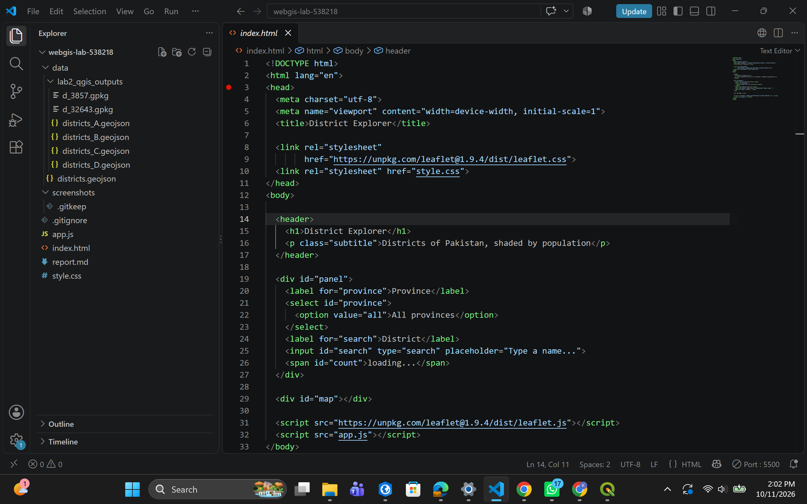

### Checkpoint 2: Version A over version D in QGIS
Version A (red, original detail) drawn over version D (blue, simplified at 1 km) at 1:250,000 in northern Pakistan. The blue lines cut straight across the bends that the red lines follow.

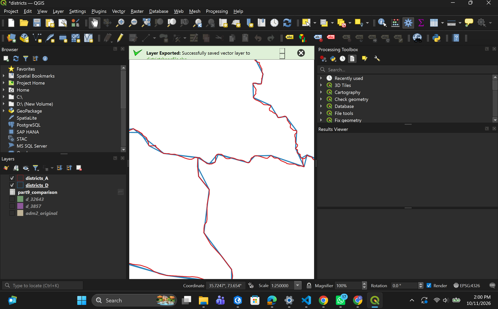

### Checkpoint 3: The GeoJSON read as text
`districts.geojson` formatted in VS Code (Shift+Alt+F), showing the nested `features`, `geometry` and `coordinates` arrays. Each pair starts with a number in the 60s or 70s, so longitude comes first.

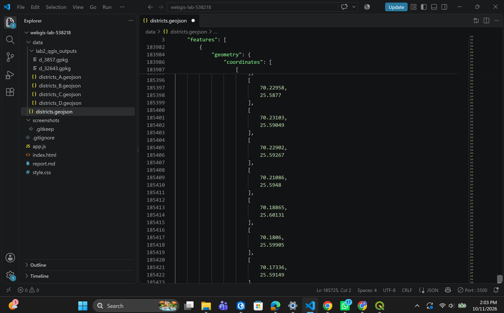

### Checkpoint 4: Page structure on Live Server
The header, controls and the empty map area, served from `127.0.0.1:5500` before the data is loaded.

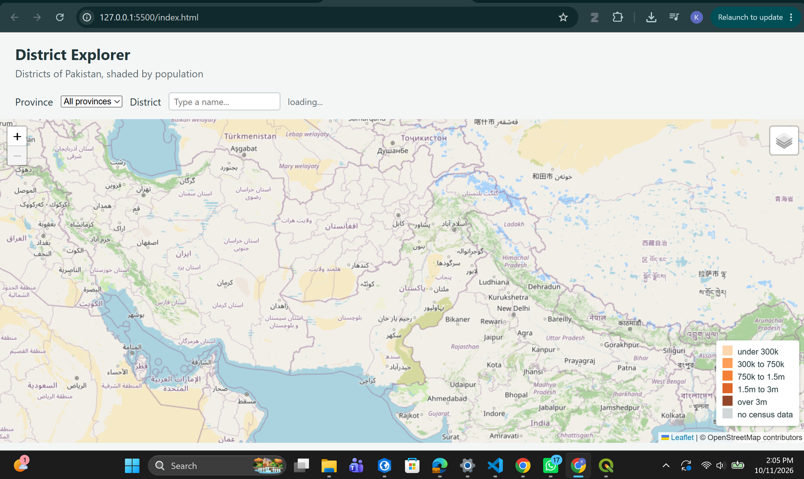

### Checkpoint 5: Data in the Console
The Console shows `features: 160`, the first feature (Bagh) expanded down to its `Polygon` geometry and coordinates, and the seven distinct provinces from `map` and `Set`.

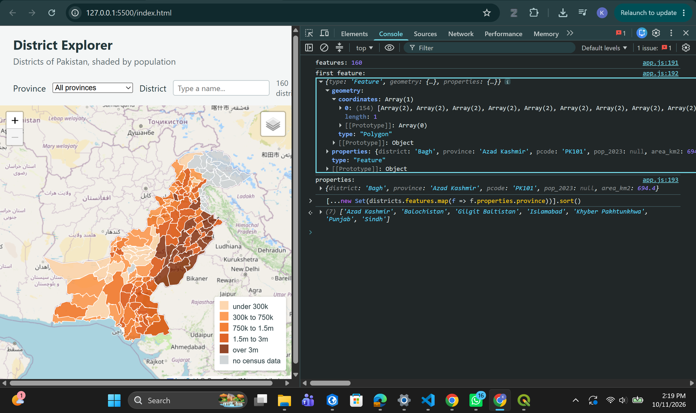

### Checkpoint 6: Network activity
The Network tab with `districts.geojson` in the request list and a map tile selected, its Preview showing a 256 × 256 image/png tile.

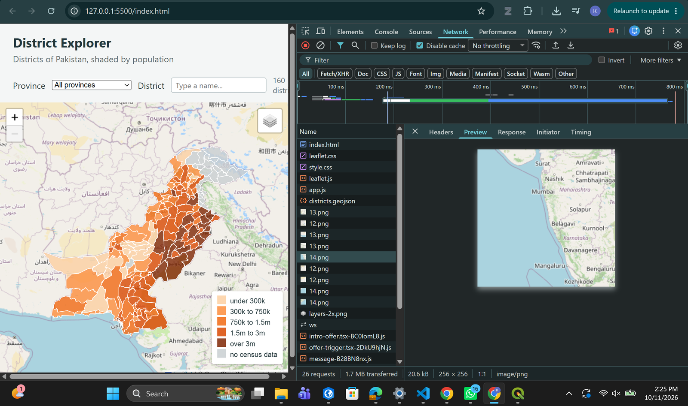

Request sizes and times with no throttling, and the same page reloaded on the 3G throttling preset:

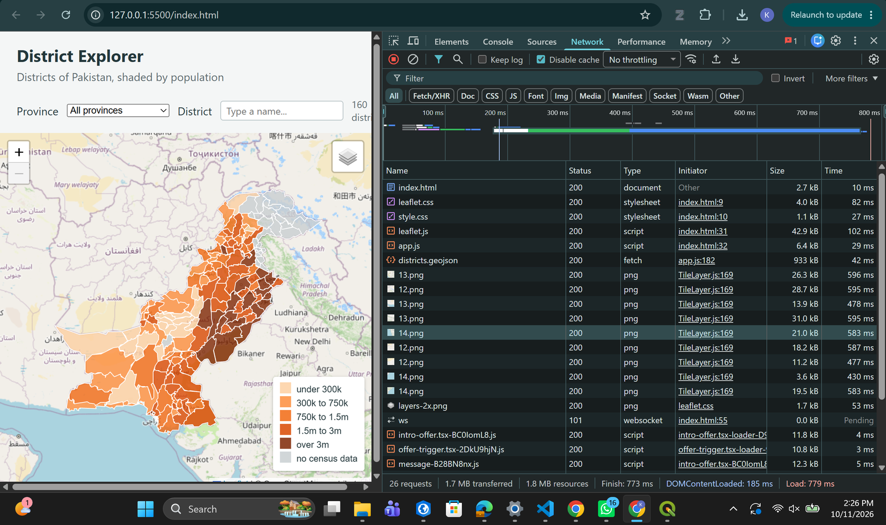

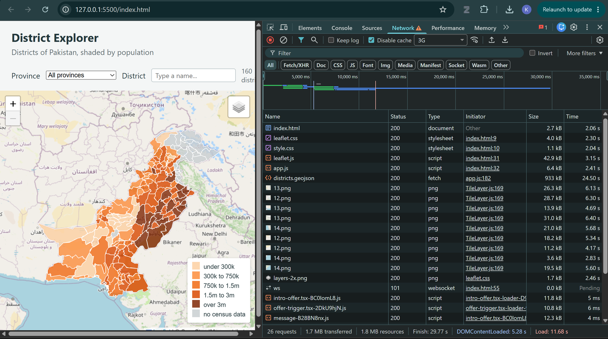

### Checkpoint 7: Choropleth, legend and popup
Districts shaded in five population classes, with the legend and the popup for Rahim Yar Khan open.

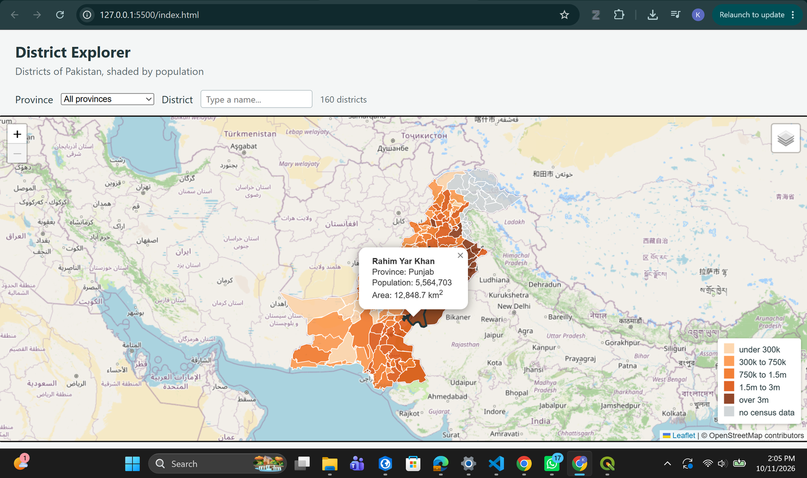

### Checkpoint 8: Province filter
All provinces (160 districts), then Punjab selected (36 districts). The map redraws, zooms to the selection and updates the count.

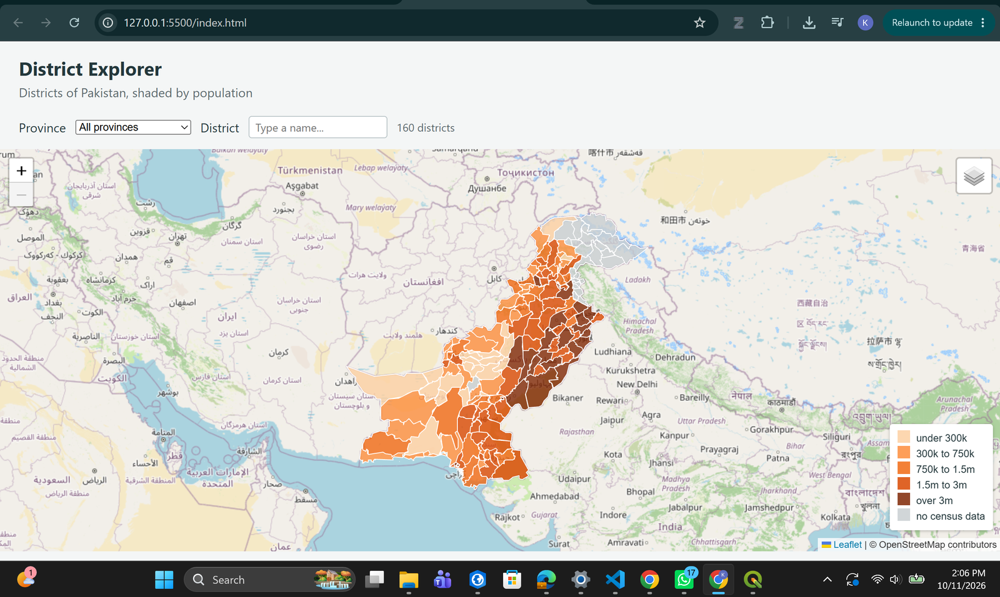

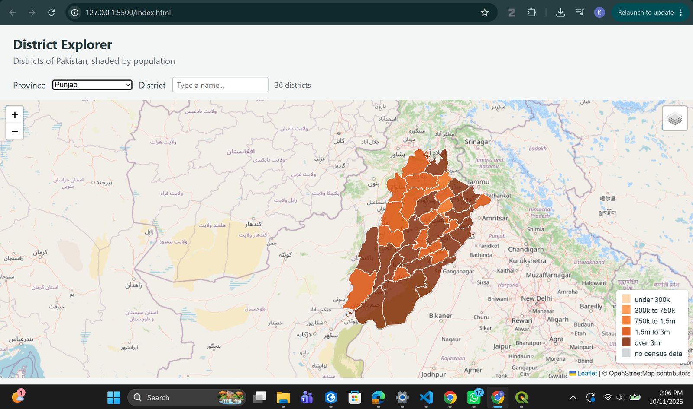

### Checkpoint 9: Coordinate system comparison
Areas of five districts from south to north, computed in Web Mercator (EPSG:3857) and UTM zone 43N (EPSG:32643), with the measured and predicted percentage difference.

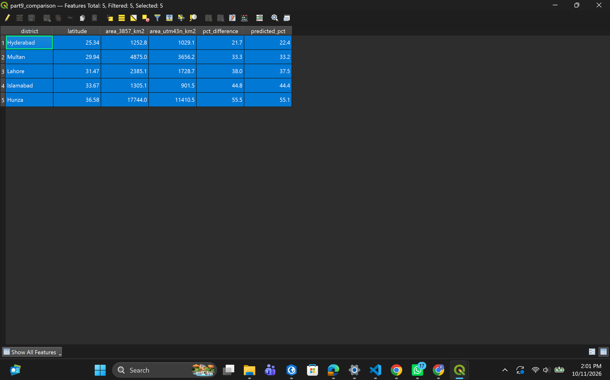

---

## 2. Data preparation (Part 2)

The source layer is `pak_admin2.shp`, the OCHA/HDX Pakistan administrative boundaries at level 2 (districts). In QGIS it reported **EPSG:4326** and **160 features**. In the original file the district name is `adm2_name` (text), the province is `adm1_name` (text) and the area is `area_sqkm` (real); it has no population field. In the copy the map uses, these are renamed to `district`, `province` and `area_km2`, and `pop_2023` is joined as an **integer**, so the classification compares numbers rather than text.

### File sizes

| Version | What was done | Size | % of A |
|---------|---------------|------|--------|
| Shapefile | adm2 .shp + .shx + .dbf + .prj + .cpg | 4.17 MB | n/a |
| A | Straight conversion, default precision | 10.66 MB | 100% |
| B | Precision 5 | 5.89 MB | 55.2% |
| C | Simplified 0.001° (~100 m), precision 5 | 1.12 MB | 10.5% |
| D | Simplified 0.01° (~1 km), precision 5 | 0.32 MB | 3.0% |

*% of A = (size of version ÷ size of A) × 100.*

Cutting the coordinates to five decimal places (B) almost halves the file without moving any vertex by more than about a metre. Simplification does most of the work: at 100 m (C) the file is a tenth of A, and at 1 km (D) it is 3%. The web map uses version C, which keeps borders accurate enough for a national or provincial view.

The `lab02/data/districts.geojson` in this repository is the course-provided version C (0.93 MB). It was simplified with topology preserved, so neighbouring districts still share exact borders, which is why it is slightly smaller than my own C exported with QGIS's Simplify tool.

**Shapefile vs GeoJSON.** My own measurement shows the same thing at the district level: the adm2 shapefile is 4.17 MB, while the straight GeoJSON conversion (A) of the same 160 features is 10.66 MB, about 2.6 times larger. The published bundles show it too: 24.3 MB as shapefile and 27.7 MB as GeoJSON. A shapefile stores each coordinate as an 8-byte binary double, so a coordinate pair costs 16 bytes. GeoJSON writes the same pair as text: digits, a decimal point, a comma, a minus sign where needed and brackets, which at full precision comes to well over 16 bytes per pair. It also repeats every property name (`"district"`, `"province"`, ...) inside every feature, while the .dbf stores field names once in its header. Reducing precision (B) and simplifying (C, D) is what brings the text format back down to a size a browser can load comfortably.

---

## 3. Reading the data as text (Part 3)

Answers from `data/districts.geojson`:

1. The outermost object is a **FeatureCollection**.
2. The `features` array has **160** entries.
3. The first feature (Bagh, Azad Kashmir) is a **Polygon**. (152 features are Polygons and 8 are MultiPolygons.)
4. There are **three** levels of square bracket before the first number: the coordinates array, the outer ring, and the coordinate pair. A MultiPolygon has four.
5. The keys in `properties` are **district, province, pcode, pop_2023, area_km2**.

**Coordinate order.** The first coordinate pair is **[73.69622, 34.08025]**. The first number, 73.7, is in the longitude range for Pakistan (61 to 77) and the second, 34.1, is in the latitude range (24 to 37), so the file is correctly written longitude first. This places the point in Bagh district, which is where the first feature should be.

**Ring closure.** The first and last pairs of the outer ring of the first feature are identical, so the ring closes.

---

## 4. Network measurements (Part 6)

Measured in Chrome DevTools with **Disable cache** ticked, serving the page with Live Server. Chrome's throttling preset is now called **3G** (the older "Slow 3G").

| Measurement | Value |
|-------------|-------|
| `districts.geojson` (version C), size transferred | 933 kB |
| Version C load time, no throttling | 42 ms |
| Version C load time, 3G | 24.50 s |
| Map tiles (`.png`) on first load | 9 tiles, 11.2 to 31.0 kB each (about 173 kB together) |
| Whole page, no throttling | 26 requests, 1.7 MB transferred, finished in 773 ms |
| Whole page, 3G | finished in 29.77 s |

Each tile is a 256 × 256 pixel PNG. The tile URL has the form `tile.openstreetmap.org/{z}/{x}/{y}.png`: the first number is the zoom level and the other two are the column and row of the tile at that zoom. DevTools lists each tile by its last part only (`12.png`, `13.png`, `14.png`), which is the row number `y`.

On my local connection the GeoJSON arrives in 42 ms, but on 3G the same 933 kB file takes 24.5 seconds, while each tile takes 3 to 6 seconds. The GeoJSON is the largest single download on the page and is what keeps the districts from appearing. I did not time version A on 3G; at 10.66 MB it is about 11 times larger than version C, so at the same rate it would take roughly four to five minutes, which is why the map uses version C.

---

## 5. Classification (Part 7)

| Class | Population | Colour | Districts |
|-------|-----------|--------|-----------|
| 1 | under 300,000 | `#fdd0a2` | 20 |
| 2 | 300,000 to 750,000 | `#fd8d3c` | 23 |
| 3 | 750,000 to 1.5 million | `#f16913` | 28 |
| 4 | 1.5 million to 3 million | `#d94801` | 40 |
| 5 | over 3 million | `#7f2704` | 24 |
| — | no census data | `#c9cfd1` | 25 |

District populations are strongly skewed: the smallest is Harnai (127,571), the median is about 1.36 million, and Lahore alone has 13.0 million. Equal-interval classes would put nearly every district in the lowest class, so I used breaks that roughly double from one class to the next, which spreads the 135 recorded districts across all five classes and still separates the large urban districts at the top. Districts in Azad Kashmir and Gilgit-Baltistan, and Lehri, are shown grey as "no census data" rather than as small, because the 2023 census did not cover them.

---

## 6. Coordinate system comparison (Part 9, extension)

Areas computed with `area($geometry) / 1000000` (planar area in each layer's own CRS; `$area` can return ellipsoidal area when the project has an ellipsoid set, which would hide the difference) on the layer exported to EPSG:3857 and to EPSG:32643 (UTM zone 43N).

| District | Latitude | 3857 km² | UTM 43N km² | % difference |
|----------|----------|----------|-------------|--------------|
| Hyderabad | 25.3° | 1,252.8 | 1,029.1 | +21.7% |
| Multan | 29.9° | 4,875.0 | 3,656.2 | +33.3% |
| Lahore | 31.5° | 2,385.1 | 1,728.7 | +38.0% |
| Islamabad | 33.7° | 1,305.1 | 901.5 | +44.8% |
| Hunza | 36.6° | 17,744.0 | 11,410.5 | +55.5% |

*% difference = (3857 − UTM) ÷ UTM × 100.*

**1. Does the difference grow or shrink going north?** It grows, from about 22% at Hyderabad to about 55% at Hunza. Web Mercator stretches the map by the same factor in both directions, and that factor increases with latitude, so northern districts are inflated more.

**2. Predicted vs measured.** For Islamabad at 33.67°N: cos(33.67°) = 0.8323, cos² = 0.6927, so the predicted inflation factor is 1 / 0.6927 = **1.444**, i.e. +44.4%. The measured difference is +44.8%. The two agree to within half a percent; the small gap comes from the district spanning a range of latitudes rather than sitting at one, and from the slight scale distortion in UTM itself. This also confirms the lecture's figure of about 1.4 times at Islamabad's latitude.

Hyderabad is the one case where the prediction (+22.4%) and the measurement (+21.7%) differ by more. Hyderabad lies at about 68.5°E, which is in UTM zone 42N, not 43N, so the UTM 43N figure is itself slightly off there. Measured in zone 42N (EPSG:32642) its area is 1,018.3 km², which matches the attribute table value of 1,018.9 km².

**3. Which figure would I report?** The UTM figure. UTM is designed to keep scale error within a fraction of a percent inside its zone, while Web Mercator overstates area by 20 to 55 percent across Pakistan. Web Mercator is only for display. For districts west of 72°E I would use zone 42N, and east of it zone 43N.

---

## 7. Answers to the questions (Part 10)

**1. Version D is far smaller than A. Give one situation in which D would be the wrong choice.**
Whenever the user zooms in to look at a district rather than the whole country. With a 1 km tolerance, small districts such as Islamabad or the Karachi districts lose most of their shape, and a boundary can be off by up to a kilometre. If someone used the map to check which district a village or a flood-affected settlement falls in, D could put it on the wrong side of the line. D is also wrong for any area or perimeter measurement, because simplification changes both.

**2. One request for the GeoJSON, dozens for tiles. Explain the difference.**
The GeoJSON is vector data: the whole file is sent once, and the browser (Leaflet) draws the polygons itself and redraws them at any zoom without asking the server again. The basemap is raster tiles: the server has already rendered the map into 256 × 256 pixel images, and the browser asks only for the tiles that cover the current view at the current zoom. Every pan or zoom needs new tiles, so the requests keep coming, but each one is small and is cached by its z/x/y address.

**3. Why does the map container need a height when the heading does not?**
A heading takes its height from its content: the browser measures the text and makes the element tall enough to hold it. The map `
` is empty in the HTML. Leaflet fills it with panes that are absolutely positioned, and absolutely positioned elements do not count towards their parent's height, so without a CSS height the div collapses to zero pixels and the map is drawn but invisible.

**4. `draw` removes the existing layer before adding a new one. What would go wrong if it did not?**
`L.geoJSON(...).addTo(map)` adds a new layer on top of whatever is already there. Without `removeLayer`, choosing a province would draw that province over the full country, so the other districts would still be visible and clickable and the filter would appear not to work. Every change would add another full layer, so the map would get slower and use more memory with each use.

**5. A classmate's districts all appear the same colour. Two causes and how to tell them apart.**
(a) The population values cannot be read as numbers, for example `"1,500,000"` with a comma or `"NA"`. Every comparison is false and every district falls to the last line of `colourFor`, so the whole map is the **palest orange**. (b) The field name in the code does not match the data, e.g. the code reads `pop_2023` but the attribute is `POP_2023`. Then the value is `undefined`, the first line of `colourFor` catches it, and the whole map is **grey**. So the colour itself tells them apart. To confirm, type `districts.features[0].properties` in the Console: it shows the real field name, and `typeof` on the value shows whether it is a number or a string. A third possibility is that `style` is still the fixed object from Part 6 rather than `styleFor`.

**6. Opening `index.html` by double-clicking: basemap appears, districts do not. Why?**
The page is then loaded from `file:///`, not from a web server. The tiles are images requested from `https://tile.openstreetmap.org`, and browsers allow images from another web server, so the basemap loads. The districts are requested with `fetch('data/districts.geojson')`, and browsers block `fetch` for pages opened from the file system (the page has no proper origin, so the request fails the cross-origin check). The request fails, `districts` is never filled, and nothing is drawn. Live Server fixes this because it serves the page from `http://127.0.0.1:5500`.

---

## 8. Additions beyond the handout

From the optional list, I added:

1. A second basemap (CARTO Light) with a layer control to switch between it and OpenStreetMap.
2. A hover highlight: the district outline thickens on mouseover and resets on mouseout.
3. A name search box that filters districts as you type. It works together with the province drop-down, so both filters apply at once.
